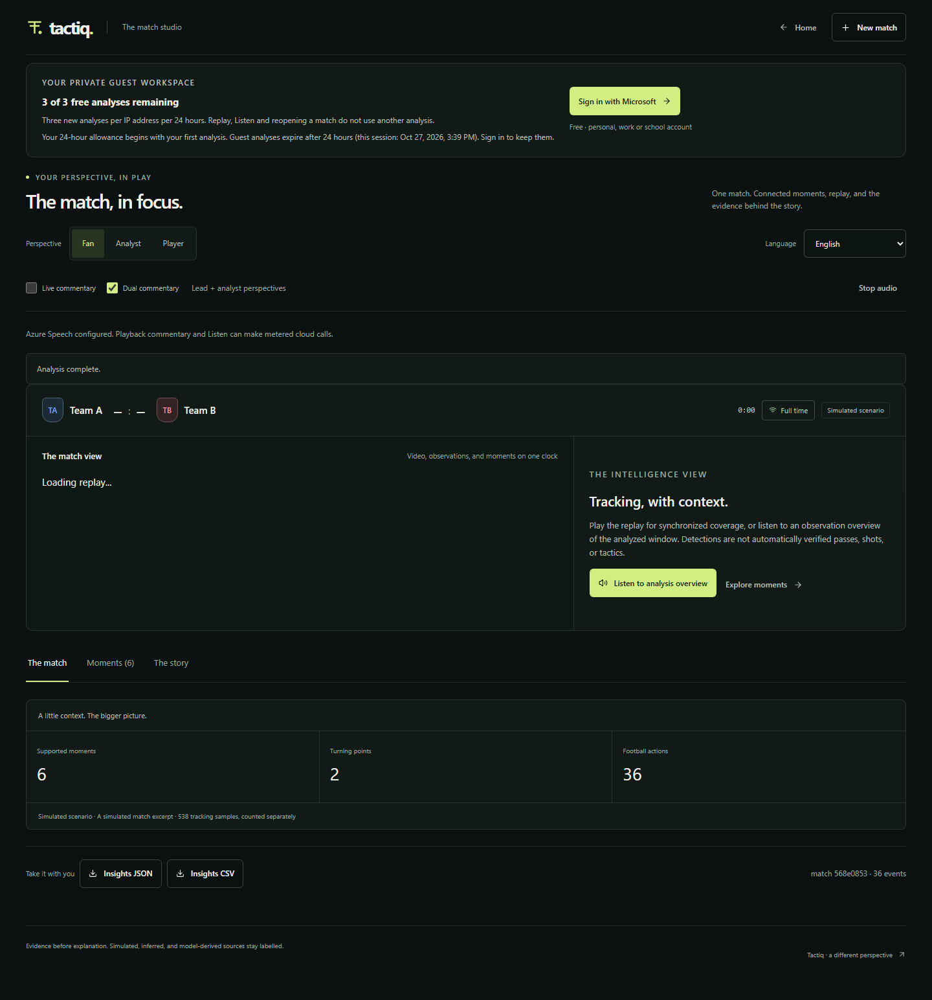
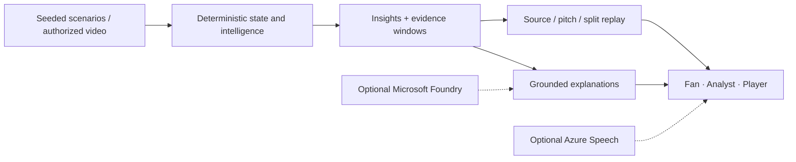

# Tactiq

### Football intelligence. Evidence before explanation.

**Tactiq turns football's "what just happened?" into "here's why it mattered."** Built for Microsoft's Inside the Game hackathon, it brings evidence-linked tactical insights, synchronized replay and AI commentary into one workspace for fans, analysts and players.

Match footage shows the action, but understanding pressure, movement and turning points takes time and specialist knowledge. Tactiq connects those moments to inspectable evidence, then explains the same underlying facts at the depth and in the language each viewer needs.

**The pitch:** watch the moment, inspect the evidence, understand the game.

[Explore the product](docs/product/user-guide.md) · [Architecture](docs/architecture/overview.md) · [Demo guide](docs/submission/demo-guide.md) · [Documentation](docs/README.md)

## What it does

**Ingest → Interpret → Explain → Replay → Personalize**

Start with a reproducible synthetic match or authorized football video. Tactiq builds match state, detects evidence-backed tactical moments and pairs them with narratives, source clips and pitch replay. Switch between fan-friendly explanations, analyst detail and selected-player focus, with seven text locales and optional spoken lead/analyst commentary.

AI explains the evidence; it does not invent the statistics. Synthetic data, missing observations and provider fallbacks stay visible.

## Built with Microsoft and Azure

| Technology | Role in Tactiq |
| --- | --- |
| **Microsoft Foundry** | Generates grounded narratives from structured football evidence through the isolated `tactiq-commentary` model deployment. |
| **Microsoft Agent Framework** | Coordinates an ordered lead/analyst exchange for two-perspective commentary. |
| **Azure AI Speech** | Turns the commentary into ordered dual-voice audio. |
| **Microsoft identity platform / Microsoft Entra ID** | Provides the certificate-backed Microsoft account sign-in integration; interactive sign-in remains unverified. |
| **Azure Container Apps and Container Apps Jobs** | Hosts the Next.js frontend, internal FastAPI backend and bounded background analysis jobs. |
| **Azure Service Bus** | Connects durable dispatch and analysis workers through an authenticated queue. |
| **Azure Blob Storage, Key Vault and managed identities** | Keeps media private, supplies runtime secrets and scopes service access without embedding credentials in images. |
| **Azure Virtual Machines, Virtual Network and Private DNS** | Runs the private PostgreSQL 17 fallback and private data-service connectivity. |
| **Azure Container Registry and Azure Monitor / Log Analytics** | Delivers immutable application images and centralizes runtime logs. |

The application combines a Next.js/React experience with Python/FastAPI, deterministic football intelligence and local ONNX video tracking. PostgreSQL runs on an Azure VM in this pilot, **not** Azure Database for PostgreSQL.

## Live Azure pilot

**[Open Tactiq](https://ca-tactiq-web-3e4d.salmongrass-337969b4.westus3.azurecontainerapps.io/workspace)** · [Deployment and production evidence](docs/azure/deployment.md)

The public UI is connected to the private API, PostgreSQL, private storage and durable cloud workers. A real synthetic scenario completed through this deployment. Cold starts can take around 90 seconds; initial job dispatch can take up to 15 minutes. The budget-sized pilot admits **one new analysis per UTC day globally**; reopening an owned analysis does not consume another admission.

[Watch the live Azure workspace recording](docs/assets/production/workspace-live.webm) · [Listen to Azure dual-voice commentary](docs/assets/production/commentary-live.mp3) · [Inspect genuine Foundry output](docs/assets/production/foundry-commentary.json)

The [release record](docs/azure/deployment.md) distinguishes verified behavior from configured integrations, provider fallbacks and remaining qualifications. Screenshots are real production captures of labelled synthetic data, not football-accuracy claims.

### Azure resource map

Owner-supplied Azure resource-visualizer snapshot for `rg-tactiq-prod-3e4d`; open the image to zoom. It includes historical bootstrap/managed-database nodes, not just the final running topology. See the [deployment architecture and resource map](docs/azure/deployment.md#azure-resource-visualizer) for current components and shared services.

## One match, different perspectives

| Perspective | What Tactiq brings into focus |
| --- | --- |
| **Fan** | A clear account of the important moment and why it matters |
| **Analyst** | Supporting windows, measurements, tactical context, and limitations |
| **Player** | Selected-player involvement where the evidence supports attribution |

Language and presentation change; the underlying facts do not.

## From a passage of play to an explanation

1. **Ingest** — Reproduce seeded synthetic scenarios or analyze an authorized video upload/link.
2. **Interpret** — Reduce events into football state, metrics, patterns, and evidence.
3. **Explain** — Build grounded narratives and lead/analyst commentary; disclose provider fallbacks.
4. **Render** — Explore moments, source clips, tracked trajectories, and synchronized replay.
5. **Personalize** — Adapt depth, player focus, language, and optional speech.

## What is available

- Versioned synthetic scenes with player/ball trajectories and reproducible event streams.
- Local ONNX tracking, surveyed camera calibration, and explicit missing-observation states.
- Evidence-linked pressure, rhythm, influence, transition, and tactical insights.
- A workspace organized around **The match**, **Moments**, and **The story**.
- A shared video/replay clock, selectable moments, source clips, and calibrated or simulated pitch views.
- Seven text locales and optional ordered dual-voice commentary, with visible fallback status.
- A single-host reference runtime with tenant-scoped token access, durable SQLite jobs, and private local media.
- An opt-in deployed cloud runtime with private PostgreSQL/Blob, database-backed guest ownership and quota ledgers, Service Bus workers, and budget-metered Foundry/Speech.

## Trust is part of the product

Synthetic scenes are labelled. Video scores remain unknown when not observed. Uncalibrated pixels are not metres; missing ball observations are not invented trajectories. The 2.5D view is a ground-plane visualization, not recovered pose or ball height. General-purpose detector output is not an independently measured football-accuracy result. Reference xT/xG estimates remain unvalidated.

**Release status:** a connected Azure hackathon pilot is deployed alongside the local reference runtime. Its completed synthetic analysis and private backup restore are verified; a configured provider flag is not proof of successful generation or interactive Microsoft sign-in. See the [dated release evidence and limitations](docs/azure/deployment.md). No enterprise SLA, 100-user capacity result, football-model accuracy guarantee, hard Azure spending cap, or production-readiness certificate is claimed.

## Explore further

| Understand | Build and evaluate | Review the release |
| --- | --- | --- |
| [User guide](docs/product/user-guide.md) | [Development](docs/development/getting-started.md) | [Judging guide](docs/submission/judging-guide.md) |
| [Architecture](docs/architecture/overview.md) | [Testing and evidence](docs/development/testing.md) | [Azure release status](docs/azure/deployment.md) |
| [Agent workflow](docs/architecture/agent-workflow.md) | [API reference](docs/reference/api.md) | [Privacy and security](docs/operations/privacy-and-security.md) |

Original application source is [MIT licensed](LICENSE). [Third-party notices](docs/reference/third-party-notices.md) cover separate dependency, model, and footage rights. Contributions and vulnerability reports follow [Contributing](.github/CONTRIBUTING.md) and [Security](.github/SECURITY.md).
