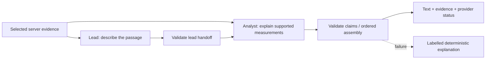

# Grounded commentary workflow

[Documentation](../README.md) · [Architecture](overview.md)

## Evidence is the shared state

The deterministic engine selects an insight and its evidence window before explanation begins. Audience, locale, selected player, temporal cutoff, and permitted entities accompany that context. A request at `at_ms` must not describe later play.

## Reference implementation

The established path performs bounded lead/analyst model calls with validated output and ordered turns. Foundry role-profile lookup supplies versioned instructions; it is **not** proof of managed agent sessions. The legacy `FOUNDRY_COMMENTARY_USE_DIRECT_AGENTS` flag selects profile retrieval, despite its name.

Number/entity/evidence validation rejects unsupported structured claims and player attribution. It does not constitute a complete semantic hallucination detector. Sparse evidence produces a shorter explanation, not fabricated depth. An explicit overview describes observations and limits instead of inventing a tactical verdict.

Broadcast and deep responses retain legacy primary/secondary fields and add ordered `turns`. Supported deep responses target four to six alternating turns and 120–180 words. Ordered Speech renders configured voices in one multi-voice SSML request; the legacy text-pair API uses FFmpeg composition.

## Failure and cost boundaries

Model authentication/deployment/quota failures open a five-minute cooldown instead of retrying unrelated deployments. Successful scripts/audio use bounded, tenant-scoped five-minute memory caches. A deterministic fallback is not cached as genuine model output.

Only explicit user generation/Listen or playback commentary should trigger paid intent; page-load explanations use local templates. Configuration/capability responses are not provider-health checks.

## Verified Agent Framework path

The deployed integration uses `FOUNDRY_COMMENTARY_USE_AGENT_FRAMEWORK=true`, alongside Foundry enablement/project/deployment settings. SDK `WorkflowBuilder` coordinates distinct lead/analyst invocations, an immutable selected-moment snapshot, validated JSON handoff, and deterministic output gates.

The new path uses locally configured versioned role profiles or versioned built-in instructions, not fetched hosted profile versions or managed agent sessions. Its audit identifies `foundry-agent-framework` / `microsoft-agent-framework`, SDK/profile metadata, request correlation, and a redacted handoff trace. Missing dependencies/provider failures must yield labelled deterministic fallback, not silently claim legacy execution as Framework success.

The path preserves existing commentary contracts and grants no arbitrary cloud administration or cross-workspace data access. Offline integration tests and actual provider evidence remain distinct. The [published verification receipt](../assets/production/dual-commentary.json) records a real ordered `lead started → grounded/handoff → analyst started → grounded/assembly` trace with `provider="foundry-agent-framework"`, no fallback and trusted SDK usage. This was a management-plane check of existing synthetic evidence, not an authenticated original-browser owned-script round trip.

The distinction is purposeful: the lead describes the observation, and the analyst explains its supported meaning using the validated lead and the same evidence boundary. Failed output/provider calls result in a disclosed deterministic fallback, not an unbounded agent repair loop. Budget reservations are not silently refunded after ambiguous calls. The receipt proves role coordination, not superiority over a single-agent baseline, hosted sessions, A2A, tool autonomy or complete failure-recovery acceptance. See the [category and judging map](../submission/judging-guide.md).

## Profile maintenance

[Profile tooling](../../tools/manage_commentary_profiles.py) is import-safe and previews only the two configured roles by default. Creating versions requires both `--apply` and an exact `--confirm-project` endpoint. It never enumerates unrelated profiles. See [configuration](../reference/configuration.md#profile-maintenance); no maintenance command is part of normal application startup.
