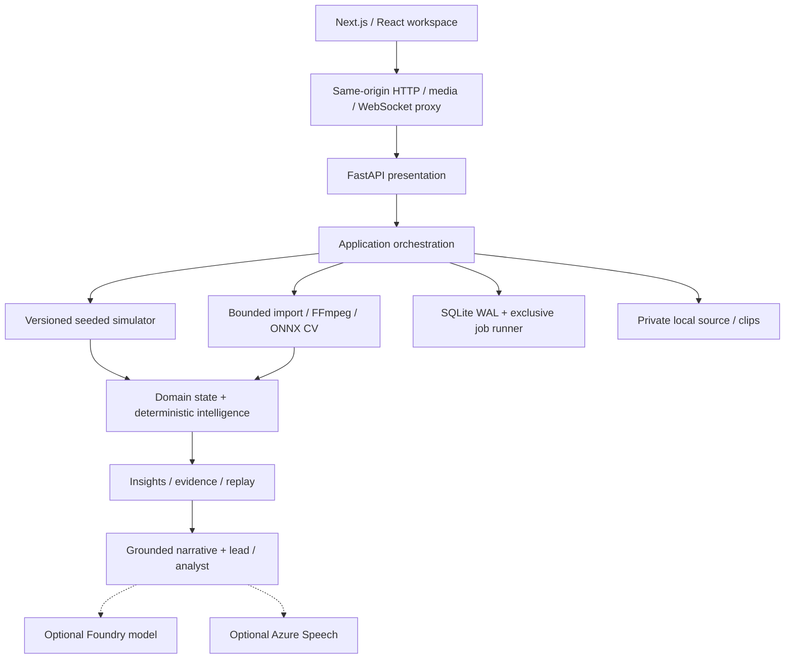

# Architecture

[Documentation](../README.md) · [Decisions](decisions.md) · [Agent workflow](agent-workflow.md)

## Reference runtime

| Boundary | Code |
| --- | --- |
| Contracts and football state | [domain](../../services/backend/tactiq/domain/) |
| Reproducible inputs | [simulator](../../services/backend/tactiq/simulator/) |
| Detection, tracking, calibration | [cv](../../services/backend/tactiq/cv/) |
| Safe video acquisition and normalization | [video](../../services/backend/tactiq/video/) |
| Metrics and insight detection | [intelligence](../../services/backend/tactiq/intelligence/) |
| Orchestration and runtime | [application](../../services/backend/tactiq/application/) · [runtime](../../services/backend/tactiq/runtime/) |
| Presentation | [API](../../services/backend/tactiq/presentation/api/) · [workspace](../../apps/web/components/) |

## Contracts that matter

- Match event sequence, rather than arrival time, orders committed facts. Reprocessing committed scenario events is idempotent.
- Recipe v2 adds multi-phase actions and trajectories; persisted v1 scenarios keep their recipe and event IDs.
- Tracking samples are not passes/shots and do not inflate action counts or football tempo.
- Replay cursors use `after_sequence`; same-timestamp frames replace earlier versions. Preparation, transport, and user playback are different clocks.
- Pitch positions use percentages of a 105 × 68 metre field. Pixel coordinates become physical geometry only with a valid survey.
- Observation, bounded prediction, and missing data remain distinct. Ball/player predictions expire after 1500 ms; camera cuts invalidate old geometry.
- Deterministic metrics create insight evidence. Narrative output cannot create authoritative statistics.
- Uncalibrated geometry, unknown attack direction, and weak ball coverage withhold unsupported claims.

## Persistence and lifecycle

The reference deployment is **single-host and single API process**. SQLite WAL persists matches, events, insights, replay, jobs, preferences, and audits. An exclusive filesystem lease owns the durable runner; process-local cache/WebSocket state is not a distributed authority.

Jobs use bounded concurrency and at-least-once recovery with completed-operation reuse. Input/media ownership, stream pins, and exact-name pending-file cleanup protect persisted results. A network filesystem is not a substitute for a distributed design.

## Connected Azure pilot

The deployed pilot separates web/API from queued analysis workers, replaces authoritative SQLite with private PostgreSQL 17 on an Azure VM, stores private media in Blob, and uses Service Bus plus transactional outbox/database leases. Container Apps/Jobs, Key Vault and managed identities connect these boundaries. The local reference remains a separate single-host runtime, not the cloud persistence authority.

Cloud synthetic analysis, private media, genuine Foundry/Agent Framework/Speech and an isolated backup restore have scoped release evidence. Microsoft identity configuration/redirect does not prove completed interactive sign-in; quotas do not establish unrestricted judge testing. See the [dated Azure release](../azure/deployment.md) and [free local judge path](../submission/demo-guide.md#free-local-judge-testing). No HA, broadcast latency, sustained-load capacity or enterprise SLA is claimed.
