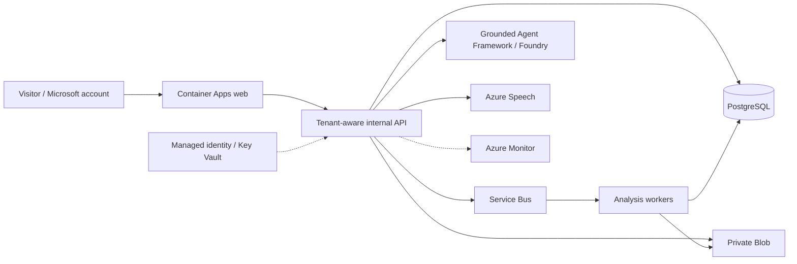

# Azure release status

[Documentation](../README.md) · [Costs](costs.md) · [Runbook](../operations/runbook.md)

> **Not deployed or cleared for public production.** The reference application works locally; cloud migration is planned/in progress. No final region, production resource inventory, public endpoint, or successful Azure cutover is asserted.

## Approved target

This target separates serving from native video processing. PostgreSQL is intended to own membership, matches/events/replay, jobs, sessions, trial quotas, usage reservations, and an outbox. Blob stores private source/clip/audio objects. Queue delivery is not authoritative state; claims, idempotency, retries, and replay resynchronization must be tested.

The target is not “put SQLite on a share” or “increase Uvicorn workers.” Cloud production must fail explicitly rather than fall back to local state.

## Implemented application boundary

The optional cloud API, PostgreSQL ownership/trial/usage store, private Blob adapter, reference-only outbox/worker and guest frontend are implemented. Grounded narrative/dual/recap generation and owned-script Speech now share durable results and application-budget reservations. See the [cloud settings and capability contract](../reference/configuration.md#distributed-cloud-runtime).

Local PostgreSQL integration and browser fixtures exercise these boundaries. They do **not** prove live Microsoft sign-in, Azure RBAC, provider availability, a 100-user deployment or public readiness. The default paid switches remain off until an approved allocation and provider configuration are supplied; changing a flag is not a deployment.

## Unresolved gates

Initial read-only planning observed a zero Container Apps managed-environment limit in three candidate regions. A subsequent check established that `Microsoft.App`, `Microsoft.DBforPostgreSQL` and `Microsoft.ServiceBus` are **NotRegistered**. This is not proof of exhausted capacity in a fully registered subscription. Registration is an unapproved control-plane change; **no deployment region is selected**.

The later Cost Management check returned approximately US$53.91 of existing-group month-to-date expenditure. Final forecast, remaining headroom and the complete release allocation are still unverified; see [cost boundaries](costs.md).

The current Windows host cannot execute Docker/Podman. Portable PostgreSQL 17.11 and a session-only Microsoft Azurite instance now provide actual local database and Blob SDK integration evidence without Azure writes. They do not prove Linux container, managed-identity or Azure networking behavior. Building a Dockerfile is not proof of a working Linux image; a separately approved capable-host/CI path is still needed.

## Release gates

| Gate | Required evidence |
| --- | --- |
| Target and cost approval | Verified capacity/region, supported database engine, exact SKUs/networking/permissions, whole-subscription budget |
| Application compatibility | Integrated cloud adapters, migration preservation, tenant ownership, ranges/upload limits, durable worker and replay contracts |
| Identity and trials | Actual Microsoft sign-in, personal-account separation, atomic quotas, promotion/expiry and abuse tests |
| Agentic execution | Actual Framework path, bounded trusted context, validated handoffs, redacted failure traces, real target-model/Speech proof |
| Linux/staging | Immutable image digests, actual ingress/body/WebSocket/range behavior, migration and restore |
| Capacity and spending | Up to 100 connected users with separately bounded processing, admission/usage controls within available allocation |
| Security and operations | Independent review, least privilege/private storage, alert tests, retention and tested rollback |
| Public handoff | Dated release/evidence links, rights/notices review, owner-approved publication/cutover |

Unit tests, configured endpoints, an SDK dependency, profile names, or fallback HTTP 200 responses do not satisfy these gates.

## Approval sequence

1. Resolve capacity and existing subscription spending; obtain separate permission for control-plane writes.
2. Approve the exact target/cost envelope before infrastructure generation.
3. Validate the scaffold and separately approve provisioning/deployment.
4. Verify staging, restore/rollback, providers, and capacity before owner-approved public cutover.

No Azure write or deployment command is authorized by this documentation. Preserve unrelated applications and local uploads. Do not add services merely to decorate a submission.

## Evidence record to complete

For the eventual release record: commit/image digests; UTC verification date; approved region/services; migration checkpoint; tests and sanitized reports; load/queue/usage limits; actual provider outputs; restore/alert/rollback results; and a stable demonstration URL. These fields are currently **pending**, not fabricated placeholders for deployed resources.
