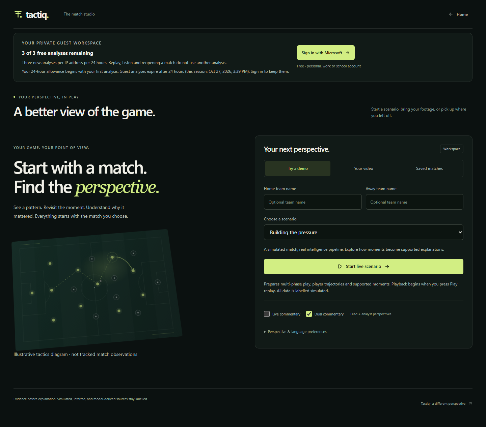
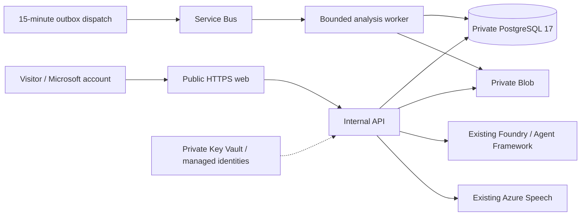

# Azure release record

[Documentation](../README.md) · [Costs](costs.md) · [Configuration](../reference/configuration.md) · [Runbook](../operations/runbook.md)

**Connected Azure pilot, 2026-10-26.** Open the [live workspace](https://ca-tactiq-web-3e4d.salmongrass-337969b4.westus3.azurecontainerapps.io/workspace) or [landing page](https://ca-tactiq-web-3e4d.salmongrass-337969b4.westus3.azurecontainerapps.io). The public frontend now reaches the real internal API, private PostgreSQL, private media storage and durable cloud workers. This supersedes the earlier frontend-only deployment and missing-API 404 diagnosis. It is a budget-limited hackathon pilot, not an HA service or a certified production-readiness result.

## Hackathon demonstration and access

The submission's primary data path is project-generated synthetic football events. The [challenge/category/judging map](../submission/judging-guide.md) connects the five required stages and Microsoft/Azure integrations to actual evidence. [Watch the entrant-supplied 1:55 pitch](https://youtu.be/ktO6Mbmkhy4); its local-browser footage and separately verified Azure audio have different scopes.

The hosted pilot's global admission cap, guest ownership/expiry, cold starts and fixed AI allocation are intentional budget controls. **Do not describe this endpoint as unrestricted judge access.** The [free local judge test](../submission/demo-guide.md#free-local-judge-testing) provides repeatable synthetic analysis/replay/recaps without provider keys or the cloud cap, but does not provide free live Azure inference. The entrant must confirm the complete offered testing route and availability through November 10, 2026 at 11:59 pm Pacific, including any separately required AI access. No quota, ownership, paid allocation or deployment setting was changed for this documentation review.

## Azure resource visualizer

[](../assets/production/azure-resource-visualizer.png)

Owner-supplied Azure resource-visualizer snapshot of the Tactiq production resource group, added on 2026-10-26. **Open the full-resolution image to zoom into resource names and connections.** It documents the resource-group topology at capture time, not a live health check, deployment sequence or complete dependency inventory. Shared Foundry, Speech and registry resources are described separately below; the image does not replace the deployment table or runtime evidence.

The snapshot still includes the temporary bootstrap job and a managed PostgreSQL node. The bootstrap job was subsequently retired, and the managed database allocation failed; the running database is the private PostgreSQL VM fallback described below. These diagram nodes do not establish that those earlier resources are active.

## Visible production evidence

These screenshots came from the actual public Azure workspace, with no mocked network routes. The match is a **labelled synthetic scenario**, not real football footage.




The first live browser run admitted match `d2041e5b-a33b-4d42-a48b-5868568e0853`, completed analysis in the cloud worker, returned owned state/replay with HTTP 200 and produced six insights. Dispatch and worker were manually started for this release check rather than waiting for the normal fifteen-minute schedule. The analysis screenshot captures a completed result while the replay panel is still loading; it does not prove finished replay rendering.

**[Watch the real public-workspace recording](../assets/production/workspace-live.webm)** · [Public connectivity/privacy receipt](../assets/production/public-connectivity.json) · [Genuine Foundry narrative](../assets/production/foundry-commentary.json)

**[Listen to the live Azure dual-voice commentary (18 seconds)](../assets/production/commentary-live.mp3)** · [Framework, Speech and private-media verification receipt](../assets/production/dual-commentary.json)

The recording is a fresh visitor opening the public landing page and workspace, including real cold-start waiting; it does not submit another analysis or impersonate the original workspace. The associated live checks verified cloud capabilities HTTP 200, another workspace's analysis denied with HTTP 401, untrusted-origin POST denied with HTTP 403, exact-origin credentialed CORS and a Microsoft login HTTP 303 redirect. A redirect is not a completed interactive sign-in.

The audio is genuine Azure Speech output from a grounded Foundry lead/analyst exchange. The management-plane check used the existing labelled synthetic evidence, not a new admitted analysis: both agents completed their ordered handoff with `fallback_used=false`; SDK usage was 1,819 input / 546 output tokens, conservatively settled at $0.07095. The 107,280-byte MP3 was uploaded with the existing API managed identity to private Blob, read back byte-identically, range-read correctly and refused by the adapter under another workspace. The temporary probe blob was deleted. This proves the provider/private-storage path, not an owned-script HTTP round trip authenticated as the original browser.

## What is deployed

| Component | Actual deployment |
| --- | --- |
| Region/resource group | `westus3` / `rg-tactiq-prod-3e4d` |
| Public web | `ca-tactiq-web-3e4d`, Next.js, 0.25 vCPU / 0.5 GiB, zero-to-one replicas |
| Private API | `ca-tactiq-api-3e4d`, internal HTTPS ingress, 0.5 vCPU / 1 GiB, zero-to-one replicas |
| Database | PostgreSQL 17 on `vm-tactiq-db-3e4d`, private `db.tactiq.internal`, retained dedicated data volume, `verify-full` TLS |
| Private media | `sttactiqprod3e4d`, private Blob endpoint, scoped managed-identity access |
| Secrets | `kv-tactiq-prod-3e4d`, private endpoint and per-secret runtime reader grants |
| Broker | `sbns-tactiq-prod-3e4d`, authenticated Basic Service Bus queue `analysis` |
| Dispatch | `job-dispatch-tactiq-3e4d`, every 15 minutes; bounded lease recovery before outbox delivery |
| Analysis | `job-worker-tactiq-3e4d`, event-triggered, one authoritative active database lease, 840-second timeout, zero platform retries |
| Guest cleanup | `job-maintain-tactiq-3e4d`, hourly |
| AI | Existing Foundry project `c0n2026`, isolated usage-billed child deployment `tactiq-commentary`; in-process Agent Framework dual commentary |
| Speech | Existing Azure Speech, seven configured locale/voice pairs, budget-metered standard Neural voices |
| Images | Existing ABAC registry; isolated `tactiq-3e4d/backend` and `tactiq-3e4d/web` repositories |

Only the frontend is public. Basic Service Bus and the existing Standard registry retain the explicitly approved authenticated public endpoints; the existing Foundry endpoint is also public. “Private data” does not mean every Azure service has a private endpoint.



### Database fallback and recovery

The approved managed PostgreSQL `Standard_B1ms` allocation failed with `SkuNotAvailable`, with automatic placement and explicit availability zones 1, 2 and 3. The owner chose to stay in westus3 and later authorized autonomous alternatives within the budget. `infra/database-vm.bicep` therefore supplies an isolated private VM fallback, not a larger managed SKU or a regional migration.

Database and SSH inbound access remain denied from the Internet. Initialization uses Azure Run Command and the VM identity; runtime uses separate nonadmin API/jobs database roles. The private CA and credentials are Key Vault secrets, not image contents or checked-in parameters. The VM requires operator patching, recovery and certificate maintenance that a managed database would otherwise handle.

Daily logical backups run at 03:15 UTC with a randomized delay and upload through the private Blob endpoint using managed identity. An actual dump (`20261026T113526Z`, 111,304 bytes) was downloaded byte-for-byte and restored into an isolated temporary database: **all 22 application tables were present**; the probe database was then dropped. Backup blobs have an eight-day lifecycle deletion rule. This verifies a logical restore, not HA, point-in-time recovery, or a full VM-loss recovery drill.

### Frontend/API connectivity and CORS

The reported reconnect/404 was caused by an absent backend, not CORS. The backend is now deployed; live `/api/v1/capabilities` through the public web returns HTTP 200 with `runtime_mode="cloud"`.

Browsers use same-origin `/api/*` and `/media/*`; Next.js proxies to the private API. Its internal target is baked into the Linux frontend build with `TACTIQ_BACKEND_URL`. Runtime environment alone cannot change a built rewrite. Exact public HTTPS origin checks and credentialed CORS are configured server-side; do not use wildcard origins or expose the backend publicly as a shortcut.

Scale-to-zero cold starts exposed Next.js's shorter default proxy deadline (`ECONNRESET`). The web image now uses a 180-second proxy timeout. A real cold-start capabilities request completed with HTTP 200 in 92.1 seconds, without introducing always-on replica cost. Allow for cold starts and up to fifteen minutes before initial dispatch, plus backlog.

Local `.env` files are development inputs and were excluded from build contexts. Production uses explicit Container Apps environment values and private Key Vault references. The API fails closed on missing cloud configuration instead of selecting SQLite.

### Microsoft identity and provider controls

The Entra app `Tactiq-Production-3e4d` uses client ID `886015c9-8273-4b63-b631-531e54f5f865`, `common` authority, organizational/personal accounts, and the exact public `/api/v1/auth/microsoft/callback` HTTPS `form_post` redirect. Implicit issuance is disabled and no Graph API permission grants are required.

Tenant policy forbids client secrets. A 3072-bit RSA confidential-client certificate was registered and delivered privately to Key Vault instead; matching key/certificate and validity are checked before startup. The pilot certificate lasts 90 days: rotate it before expiry. Configuration and a login redirect are **not proof of a completed interactive Microsoft sign-in**; no user password is collected by release automation.

Foundry/Speech remain behind the fixed $6.50 shared application allocation. Single narratives reserve exact prompt bytes plus completion/envelope bounds; two-role commentary reserves 138,392 tokens: two times (64,000 serialized input bytes + 1,100 completion tokens + 4,096 tool-free envelope tokens). Successful complete SDK usage settles only after durable results; fallback, partial and ambiguous operations retain reservations. No automatic paid retry is made. SDK deadlines are 60 seconds per call, 130 seconds for the full two-role workflow.

The original shared model deployment allowed only one request and 1,000 tokens per minute, causing HTTP 429 on the schema-complete request. `infra/commentary-deployment.bicep` adds only `tactiq-commentary` (20 requests / 20,000 tokens per minute) under the existing account. The shared deployment, account, project and network were not changed. This is Global Standard pay-as-you-go throughput, not provisioned hourly capacity; the application allocation and conservative token price remain unchanged.

At 15:51 UTC, the corrected single-narrative probe returned `provider="foundry"`, `fallback_used=false`, passed grounding and reported 1,121 input / 620 output tokens. Its conservative ledger settlement was $0.05223, not an exact Azure invoice. This probe used existing labelled synthetic evidence through the management plane; it is not browser-authentication evidence. The earlier timeout/invalid-output/quota fallbacks are not presented as genuine model success.

Speech's real voice-list and short synthesis probes succeeded (HTTP 200; 20,016-byte MP3). This proves provider credentials/voice availability, not the entire owned-script/private-media browser path. `provider_health_verified=false` in capabilities deliberately remains a configuration-time statement rather than an unconditional health promise.

## Immutable deployed images

Registry: `b8e2968c0n2026ca14acr.azurecr.io`. No admin/anonymous access or registry mode changes were made. Repository-conditioned Reader/Writer roles are used because this registry is ABAC-enabled.

| Artifact | ACR run | Repository and digest |
| --- | --- | --- |
| Web, cold-start proxy correction | `df6` | `tactiq-3e4d/web@sha256:070df89ad3d785b30dafb7f734da025c3a9e90e7d9f45b9b2dc127bd780beac5` |
| Backend, private TLS/certificate, grounded JSON and Azure async transport | `dfa` | `tactiq-3e4d/backend@sha256:526e261fc72297d5d96f0d4cbcab250236eadb717eed80c79be7d876f7792ffd` |

`infra/scripts/stage_build_context.py` copies a source/configuration allowlist before upload. Secrets, `.env`, media, session files and model weights are excluded. The Linux image checks Framework imports and construction of Azure's async HTTP transport during its build; `aiohttp` is explicitly locked in the Foundry extra, not accidentally supplied by development dependencies. `tools/fetch_detector.py` downloads the official digest-pinned YOLOX-tiny artifact/license at build time and bundles its notice. No model download occurs during request processing. Packaging is **not a measurement of football-video accuracy or proof that a production video job has completed**; see [third-party notices](../reference/third-party-notices.md).

## Operating and redeploying safely

The original `infra/main.bicep` describes the approved managed-PostgreSQL foundation. **Do not rerun it blindly over the VM fallback**: it can retry the unavailable server and reinstate bootstrap elevation. `infra/runtime-only.bicep` references the existing environment, identities and vault for connected runtime updates; `infra/database-vm.bicep` is the fallback infrastructure. The plan preserves historical approval and failed-attempt evidence; its current execution record supersedes those earlier states.

The temporary bootstrap job and its encrypted input were deleted after all probe executions terminated. The bootstrap and database-initialization Key Vault Secrets Officer grants and bootstrap registry Reader grant were explicitly removed. The bootstrap database role is `NOLOGIN`; API/jobs remain nonadmin login roles and the daily backup timer remained active. Per-secret runtime readers and the database backup-container writer were preserved.

**Management hardening exception:** Azure rejected disabling the VM's `allowExtensionOperations` flag with `OperationNotAllowed`, reporting extensions present even though both the extension resource list and VM instance view showed none. A minimal PATCH returned the same error. The flag remains enabled; this is not represented as completed hardening. Internet SSH/database ingress is still denied, and no bootstrap secret-writer grant remains. Do not destroy/recreate the database VM to clear this provider state. Resolve the discrepancy through Azure support or a separately reviewed maintenance window; privileged Azure operators can still use the VM agent.

All infrastructure updates are incremental, after compilation, invariant/static checks and review of actual what-if output. Preserve unrelated shared resources and authenticated registry mode. Never use a complete-mode deployment to clean up this resource group.

```powershell
az bicep build --file infra\runtime-only.bicep
az deployment group what-if --resource-group rg-tactiq-prod-3e4d `
  --template-file infra\runtime-only.bicep --parameters '@<private-runtime-parameters.json>'
# Review the actual preview before creating the deployment.
az deployment group create --resource-group rg-tactiq-prod-3e4d `
  --name tactiq-connected-release --mode Incremental `
  --template-file infra\runtime-only.bicep --parameters '@<private-runtime-parameters.json>'
```

Keep the budget start/end fixed across redeployments: `1793014623` through `1795606623` UTC epoch seconds. It does not renew automatically. Rotate/review provider credentials, the 90-day Microsoft certificate and database TLS certificate independently. Never compile secure bootstrap values into a local JSON file or upload the worktree wholesale.

Use resource-specific `ContainerAppConsoleLogs` / `ContainerAppSystemLogs` in the Tactiq Log Analytics workspace for terminated job logs; individual execution replicas may already be gone. Do not publish cookies, credentials, private source media or raw provider error bodies as evidence.

## Pilot qualifications and remaining verification

The whole-subscription **conditional estimate is $146.13/month**, not a hard Azure billing cap. Native admission is one per UTC day globally; the guest's three-trial entitlement does not override it. Serving assumptions, image transfer, telemetry and unrelated resources can exceed the estimate; see [cost boundaries](costs.md).

The first public synthetic analysis, backup restore, genuine single/dual Foundry output, Speech generation, private Blob round trip/range/adapter ownership checks, public CORS and cross-workspace HTTP denial are verified with the separate scopes above. Interactive Microsoft sign-in, the original browser's owned Speech/private-media playback, production video inference, distinct-client forwarding-chain checks, failure recovery and sustained-load capacity remain unverified. No 100-user capacity, HA/SLA, football-model accuracy or fully verified Microsoft login claim is made.

During release validation, 28 of 31 production-build browser cases passed together; the three contention-sensitive failures all passed in an isolated rerun. The reconnect regression passed without increasing timeouts. CI now tests the already-built frontend instead of recompiling routes in development mode. The full local Python run had one FFprobe contention timeout; that case passed in isolation. Targeted cloud/identity/infrastructure and provider-contract suites passed, as did lint, Bandit and the updated dependency audit. These are not a production-readiness certification.
