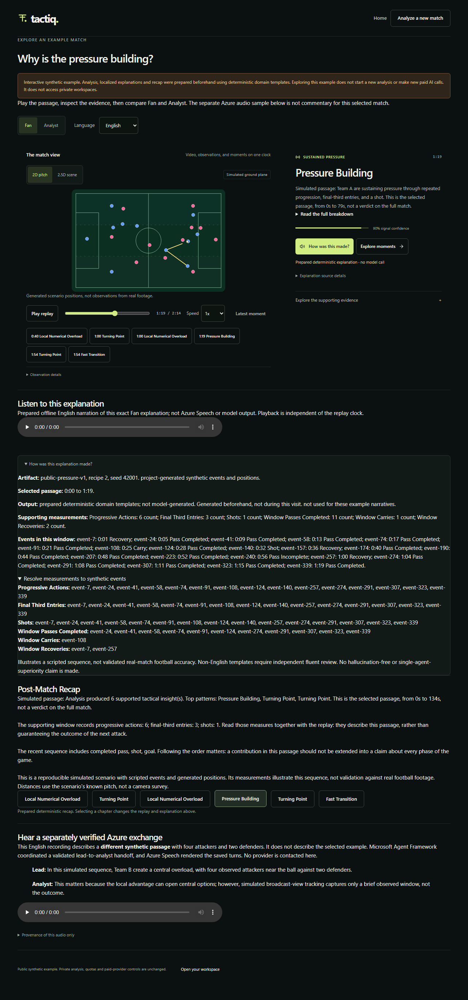

# Judge experience: scope, reproductions and verification

[Demo instructions](../submission/demo-guide.md#immediate-prepared-example) · [Agent boundary](../architecture/agent-workflow.md#timestamp-and-locale-boundary-repairs) · [Measured receipt](../assets/examples/verification.json)

## Public example and provenance

This source revision adds `/example` and landing/workspace links. It reuses `TacticalReplay`, `SelectedMoment` and `InsightEvidence`; a narrow `preparedPayload` input replaces replay fetching only for the public example. No workspace API, session bootstrap, database, queue or paid provider is involved. Private routes and quotas are unchanged. The Azure pilot and existing YouTube video have **not** been updated.

The versioned [public package](../../apps/web/public/examples/pressure-v1.json) comes from `MatchService`, the actual seeded simulator and deterministic narrative/recap generators with `paid_providers=False`. It contains six supported insights, recipe 2, seed 42001. The public identifier is a catalogue key, not a guest record. The builder never imports or reads an existing workspace. Player and event identities remain synthetic.

The replay preserves the canonical schema. It samples existing positions at 2 fps, within the renderer's 500 ms interpolation bound, rounds entity coordinates to 0.001 normalized units and omits unused tactical fields. Metrics still use original events; replay rounding is not a new football measurement. Units remain in canonical provenance, and per-metric references resolve to public synthetic event keys in the same window. Analyst output moves the existing measurement paragraph to the front. It is not a separate analytical engine.

Pressure Building / English / Fan has matching **offline Windows narration**, with the exact written narrative available in its full breakdown. Other combinations explicitly disclose missing audio. The separate Azure clip is byte-identical to the existing published provider sample and describes a **different** four-attacker/two-defender passage. Its transcript/role provenance is displayed independently. No trace from that clip is attributed to the deterministic match.

[](../assets/examples/public-example.png)

### Regenerate deliberately, never from a guest analysis

```powershell
.\.venv\Scripts\python.exe tools\build_public_example.py
.\tools\build_example_audio.ps1
```

The second command requires Windows System.Speech and Microsoft Zira Desktop. Browsing the committed package does not. Rebuilding the JSON is deterministic and tested against the committed artifact twice; audio bytes can vary with platform/voice versions. If changing its English Fan text, regenerate the paired recording and update the evidence receipt. Voice/service rights remain a separate entrant review.

## Timestamp reproduction

**Confirmed before fixing.** Canonical `Event` requires a nonnegative timestamp, but `_contextualize_insight` omitted it in phase-event dictionaries. `MomentEvidence` then treated missing timestamps as window start. Null/string/malformed context could also raise incidental type errors, and applying the last-eight bound before filtering could discard valid context in favor of future entries.

The producer now preserves timestamps. The Framework snapshot accepts only actual nonnegative integer values, uses inclusive start/end boundaries, filters before taking the last eight, and retains timestamps in the serialized evidence. Invalid individual context events are omitted with a count-only warning, not defaulted. A malformed collection is rejected before the first call.

Tests capture both actual installed-SDK agent prompts and inspect their parsed `INPUT_JSON`. They cover inside/start/end, before/future, missing/null, numeric/nonnumeric strings, boolean, integral float, NaN, infinity, negative and mixed events, plus collection rejection with zero provider invocations. Service regression asserts upstream timestamps survive. Canonical schema tests separately show that Pydantic can normalize booleans/numeric strings/integral floats; that guarantee does not apply to arbitrary context.

## Seven-locale reproduction and policy

Fixed evidence: six progressive actions, one shot, known `team_a` / `a_10`, supporting IDs `e1` / `e2`, window 60-90 seconds. Locale IDs come from the existing seven-locale catalogue. No live model or translation-verifier call was made.

| Category | Before | After |
| --- | --- | --- |
| Correct canonical digit/metric statements | Accepted in all seven tested locales | Accepted; entity and structured-reference checks retained |
| Unsupported number words, whole-match conclusion, goal, unknown named team, wrong metric association, mixed-language false prose | English examples rejected; six translated variants per category accepted | All tested variants rejected |
| Unsupported canonical player ID / structured entity / event reference | Existing structural checks reject | Still rejected before localized rendering |
| Correct number words | English case checked; other locales accepted without semantic checking | English checked; other free-form variants explicitly **unverified**, triggering fallback rather than pretending false or proven |
| Misleading prose plus a correct structured claim | Six translated false narratives reached successful Foundry-shaped output through offline transport | Every tested false narrative becomes a disclosed deterministic fallback |

The initial combined reproduction run was **52 failed / 22 passed** against the new intended policy. Some failures were new conservative-policy assertions, not proof of an existing factual bug; the actual semantic bypasses and the six successful false-output reproductions are distinguished above. Timestamp collection checks also exposed incidental type errors rather than the intended rejection.

The repair does **not** add a short translated-number blacklist. Structured claims are checked first. Non-English model prose must then match evidence-derived domain fragments or canonical claimed digit/metric statements exactly; otherwise `UnverifiedLocaleError` reaches the established fallback, with `validation_boundary=unverified-localized-prose` where applicable. This intentionally rejects some valid wording. All seven locales remain selectable through localized deterministic rendering. Approved localized output and actual SDK handoffs retain positive tests.

The language fixtures and templates have not had independent fluent review. Matching a template proves a bounded rendering contract, not that every translation is linguistically correct. English checks remain incomplete semantic heuristics. Neither result establishes hallucination-free generation or real-football accuracy.

## Verification on 2026-10-27

| Check | Actual result |
| --- | --- |
| Full Python regression run | 1,232 passed / 53 skipped |
| Production Next.js build and type validation | Passed; `/example` statically prerendered |
| Frontend unit runner | 25 passed |
| Complete production-bundle browser suite | 35 passed, including original new-analysis, sign-out, trial/quota, ownership, replay and Speech-fixture journeys; all four example tests passed again after final unit/reference presentation changes |
| New example browser checks | Replay play/pause/seek and 2.5D; moment changes; Fan/Analyst; Swahili; evidence/provenance; matching audio playback; recap; refresh; mobile; missing audio; explicit failed/malformed package |
| No-cost/isolation observation | Zero `/api/` and external requests, zero cookies during successful public-example exploration and refresh; failures never initiate analysis |
| First usable example | **1,784 ms** in the final example rerun, fresh Chromium cache, local warm production server, 20 Mbps down / 5 Mbps up and 50 ms added latency; one controlled run, not Azure cold-start acceptance |
| Ruff, Bandit, offline smoke | Passed; smoke explicitly reports `production_ready=false` |
| Backend locked dependency and frontend production dependency audits | No known vulnerabilities reported by the commands run |
| Local cloud integration | 52 explicitly skipped: no approved disposable PostgreSQL/Azurite configuration; no production database used |
| Other optional integration | Licensed real-ONNX fixture unavailable; not claimed tested |

An initial broad browser attempt used an existing build without the required API rewrite/Speech build flags and was stopped after failures. A targeted example attempt also found overly broad test alert selectors matching Next's route announcer. The selectors were fixed, the original mobile entry layout preserved, and all 35 browser tests were rerun successfully with explicit flags and fresh test database/media paths. No failing run is represented as passing.

### Exact local commands

```powershell
.\.venv\Scripts\python.exe -m pytest -q --tb=short
.\.venv\Scripts\python.exe -m pytest tests\unit\test_public_example.py tests\unit\test_judge_grounding_regressions.py tests\unit\test_judge_timestamp_regressions.py tests\unit\test_agent_framework_workflow.py tests\unit\test_grounding_and_localization.py tests\unit\test_rich_commentary.py -q --tb=short
.\.venv\Scripts\python.exe -m pytest tests\integration -q -rs
.\.venv\Scripts\python.exe -m ruff check services\backend\tactiq tests tools\build_public_example.py
.\.venv\Scripts\python.exe -m bandit -r services\backend\tactiq -ll -q
.\.venv\Scripts\python.exe -m tactiq.evaluation smoke --output .artifacts\judge-smoke.json
.\.venv\Scripts\python.exe -m pip_audit -r requirements.lock --strict
```

From `apps\web`, after dependencies are installed:

```powershell
node --experimental-strip-types --test tests\replay.test.ts tests\workspace.test.ts
npm audit --omit=dev --audit-level=high
$env:TACTIQ_BACKEND_URL="http://127.0.0.1:18765"
$env:NEXT_PUBLIC_API_BASE_URL=""
$env:NEXT_PUBLIC_ENABLE_CLOUD_SPEECH="true"
$env:TACTIQ_E2E_PRODUCTION="true"
$env:TACTIQ_E2E_DATABASE_PATH=Join-Path (Resolve-Path ..\..) ".artifacts\judge-final-a.sqlite3"
$env:TACTIQ_E2E_MEDIA_DIR=Join-Path (Resolve-Path ..\..) ".artifacts\judge-final-a-media"
node node_modules\next\dist\bin\next build
node node_modules\@playwright\test\cli.js test
```

Use fresh database/media paths for a repeated isolated run. Build settings are not production deployment settings. The Playwright launcher now invokes Next directly so Windows does not lose forwarded npm arguments.

### PR review follow-up

The public-package guard now requires replay metadata and validates each replay insight's consumed fields, along with warning collections, display names and replay clocks. Eight browser mutations of the otherwise-valid package, including missing metadata and `[null]` insights, verify the incomplete-package notice, functioning Retry control, successful recovery and absence of page errors/API calls.

Translated recap headings and chapter navigation now carry the selected `lang` and automatic text direction, without changing English instructional text. Browser regressions check Swahili and Arabic labels, inherited chapter language and actual Arabic RTL direction. The production build/type check and all **14 example browser tests** passed after these review fixes; the earlier 35-test result above describes the original full-suite run, not a new full-suite run.

## Judging value and remaining limits

Immediate exploration primarily supports User Experience & Presentation; traceable evidence and regression tests support Technological Implementation and Agentic Design. This is not a predicted official score.

The optional controlled single-agent comparison was not performed. No new paid-provider call, live Azure deployment, unrestricted new-analysis access, fluent-language review, independent football benchmark, sustained-load test, sign-in acceptance or user study is claimed. The next high-value external validation is a short independent first-use exercise and fluent review of the enabled locale templates, not another agent or Azure service.

Official repository rules were re-read on October 27: the deadline remains 23:59 Pacific, and post-deadline substantive changes are not generally authorized. The submitted video and hackathon project page are unchanged. A PR alone does not make this revision live or amend the competition submission.
